# Deep research RME ASR v5

Tanggal penelusuran: 3 November 2026. Fokus: dikte medis Bahasa Indonesia menjadi draft transkrip RME yang diperiksa dokter. Tujuan pengguna adalah produk RS/klinik; integrasi SIMRS tidak dibahas. Riset ini menelaah paper, model/dataset card, implementasi resmi, dan laporan komunitas. Temuan dipakai untuk membuat eksperimen yang dapat dipalsukan melalui pengujian; v5 belum merupakan model baru dengan skor terukur.

## Kesimpulan yang mengubah arah v5

Bukti pengguna sudah lebih berharga daripada mengganti arsitektur secara spekulatif. Pada benchmark internal 2.094 klip, v4 WER29,23% vs base30,96%, dengan CI delta negatif. Medisco sekitar8,86%, sementara video31,56%; label belum gold. Loop panjang tidak terdeteksi pada decoding v4. Artinya perbaikan berikutnya perlu menguji kecocokan domain dan kebenaran label, bukan hanya menambahkan anti-loop atau mengejar loss rendah.

V5 mempertahankan kontrol v4, menambahkan pemurnian dan human adjudication, lalu membandingkan adaptasi decoder vs tambahan adapter encoder atas. Dua bagian dev dipisahkan berdasarkan grup untuk selection dan confirmation. Test lama tetap regresi internal karena telah dipakai menelusuri bug. Pengujian klinis eksternal baru tetap dibutuhkan.

## A. Big data: ukuran, keberagaman, dan hak pemakaian

Whisper asli menunjukkan manfaat weak supervision berskala besar dan keragaman bahasa/domain, tetapi hasil foundation model tidak berarti caption bising lokal aman untuk diagnosis atau dosis. [S01](https://arxiv.org/abs/2212.04356)

Untuk proyek ini, data perlu dipisahkan menjadi empat tingkat:

| Tingkat | Syarat | Peran |
|---|---|---|
| Gold klinis | Audio klinis/dikte yang sah; dua reviewer; adjudikasi; speaker/session/site; verbatim | Adaptasi bernilai tinggi, dev dan test yang benar-benar independen |
| Silver | Label sumber belum didengar lengkap; technical audit lolos; provenance jelas | Pengembangan awal dengan pelaporan keterbatasan |
| Teacher/pseudo | Prediksi model disertai uncertainty/disagreement | Prioritas review atau eksperimen pseudo-label terpisah; jangan disebut gold |
| Synthetic | Skrip terkontrol, suara sintetis, provenance TTS | Melengkapi istilah langka; tidak menjadi test utama |

Dataset sekarang sekitar107,6 jam secara teknis, bukan107,6 jam gold RME. Nama kategori `Real_Hospital` tidak membuktikan isi konsultasi nyata; kunjungan gedung, seminar, pendidikan dan OSCE memiliki pola ujaran berbeda dari dikte dokter. Repetisi audio lintas Level2/3 juga tidak menambah informasi baru.

MEDISCO relevan sebagai korpus medis Indonesia yang relatif kecil; SEACrowd melaporkan4.680 utterance,10 jam dan731 istilah. Korpus baca tidak otomatis merepresentasikan dialog spontan, suara pelan, self-correction atau kebisingan klinik. [S02](https://huggingface.co/datasets/SEACrowd/medisco)

FLEURS berguna sebagai kontrol bahasa umum dan menyediakan informasi korpus multilingual; dataset card mencantumkan CC-BY4.0. File FLEURS dalam arsip pengguna tetap dikarantina karena durasinya tepat separuh metadata, sehingga perlu dibandingkan kembali dengan sumber. Mengganti header sample rate tanpa pemeriksaan tidak dibenarkan. [S03](https://huggingface.co/datasets/google/fleurs)

Sumber tambahan yang masuk akal: koleksi dikte berizin dari RS/klinik, MEDISCO setelah pemeriksaan ketentuan sumber asli, speech Indonesia umum yang lisensinya sesuai versi, dan pasangan hard-positive/negative dari lingkungan target. Jangan menyamakan lisensi loader dengan lisensi semua audio. Card SEACrowd mencantumkan GPL3; tinjau sumber asli dan ketentuan distribusi yang relevan sebelum klaim hak komersial. Common Voice, CoVoST dan turunannya bukan satu lisensi/jenis tugas yang dapat dipertukarkan; verifikasi tiap versi dan task sebelum impor. V5 tidak otomatis mengunduh korpus baru atau menyatakan hak komersial tersedia.

Rencana pengumpulan **usulan proyek, bukan standar publikasi/global**:

1. Mulai dengan batch50 jam gold dikte yang mewakili spesialisasi, dokter, mikrofon dan gaya klinis target. Ukur apakah koreksi label memperbaiki WER/error kritis dibanding silver yang sama.
2. Perluas bertahap100→250→500 jam bila learning curve pada cohort tetap membaik. Jangan menetapkan1000 jam sebagai prasyarat tanpa hasil learning curve dan analisis domain.
3. Jatah koleksi ditentukan error: obat/dosis/desimal, alergi/negasi, angka vital, aksen, jauh/dekat mikrofon, noise, ucapan pelan dan koreksi diri. Laporkan jam unik, jumlah dokter/session/site dan cakupan istilah; jam saja tidak cukup.
4. Sisihkan cohort site/speaker/time terpisah sebelum transkripsi dan tuning. Tetapkan ukuran melalui CI dan variasi antarsesi, bukan sekadar persentase acakklip.

Untuk data berskala besar, gunakan object store berizin, manifest JSONL/Parquet berversi, SHA256 audio, transcript lineage, data cards dan job audit terpisah. Notebook Colab v5 adalah jalur eksperimen; bukan scheduler training terdistribusi atau penyimpanan produksi skala ribuan jam.

## B. Pemurnian data: apa yang aman diotomatisasi

Pipeline v5 mempertahankan validasi decode, durasi aktual, finite samples, PCM hash, konflik label dan split komponen sumber. Penambahan:

- CSV adjudication memakai dua reviewer berbeda, hash audio dan split yang benar. Perubahan train tidak boleh menyentuh test. Koreksi hasil LLM tidak dipilih otomatis.
- MinHash word4gram untuk kandidat kemiripan lintas split; hasilnya audit, bukan bukti pasti audio duplikat. Phrasing klinis umum dapat cocok secara sah. PCM exact juga tidak mencakup re-encoding, crop overlap dan rekaman ulang; fingerprint audio perceptual/speaker embeddings masih pekerjaan audit terpisah.
- VAD menemukan data berlabel yang tidak memiliki speech terdeteksi. Data tersebut dikarantina untuk review, tanpa menganggap VAD oracle. Label loop ekstrem juga diprioritaskan, sementara pengulangan pendek yang sah tetap dipertahankan.
- Satu grup rekaman dibatasi300 klip secara default dan synthetic maksimal5% train. Ini hipotesis pengurangan dominasi sumber, bukan rasio optimal ilmiah; file yang terpotong oleh cap dicatat. Eksperimen berikutnya perlu ablation cap off/300 dan synthetic0/5/10% di dev.
- Teacher besar mengaudit sampel256 klip train yang tersebar per grup. Skor disagreement, token kritis dan kegagalan decoding menjadi urutan review. Teacher tidak pernah melihat test untuk menyaring label atau menjadi pengganti otomatis `ref`.

Distil-Whisper mendukung pentingnya memilih pseudo-label berkualitas dan menyediakan kode filtering; threshold10% pada eksperimen English mereka tidak boleh diimpor sebagai aturan gold klinis Indonesia. V5 menggunakan disagreement sebagai prioritas dengar, menghindari memfilter seluruh aksen sulit hanya karena model teacher gagal. [S04](https://arxiv.org/abs/2311.00430), [S05](https://github.com/huggingface/distil-whisper/blob/main/training/README.md)

uDistil-Whisper meneliti seleksi tanpa ground truth yang berguna pada data terbatas. Ini mendukung eksperimen quality estimation, bukan kesimpulan bahwa model dapat membuktikan labelnya sendiri benar. V5 belum mengimplementasikan estimator paper tersebut. [S06](https://aclanthology.org/2025.naacl-long.296/)

Forced alignment dapat membantu menemukan referensi terlalu panjang, batas segmen salah atau ketidakcocokan audio-label. Alignment tidak memvalidasi makna obat/dosis. Gunakan aligner yang memang mendukung bahasa dan kondisi audio target; WhisperX menyediakan mekanisme alignment/diarization, tetapi bukan bukti otomatis cocok untuk seluruh data Indonesia. Word alignment bukan implementasi default v5; segmen30 detik yang bermasalah tetap memerlukan realignment/label ulang. [S07](https://github.com/m-bain/whisperX)

## C. Freeze dan train: apa yang sebenarnya diubah

Tidak ada persentase freeze universal untuk RME. Penelitian low-resource Whisper menemukan manfaat pembaruan lapisan atas dan perbedaan hasil antarbahasa/data. Hasil penelitian tersebut tidak langsung memvalidasi Turbo Indonesia; ia menjadi alasan menguji ablation, bukan membakukan jumlah lapisan. [S08](https://link.springer.com/article/10.1186/s13636-024-00349-3)

LoRA membekukan semua bobot dasar dan menambahkan matriks adaptasi berperingkat rendah. Dengan demikian, “adapter pada encoder atas” tetap mempertahankan100% bobot pretrained dalam keadaan frozen, sambil memungkinkan fungsi encoder berubah melalui adapter. Persentase trainable dihitung terhadap base+adapter, bukan persentase lapisan yang di-unfreeze. [S09](https://huggingface.co/docs/peft/v0.18.0/package_reference/lora)

Perhitungan menggunakan konfigurasi Whisper Turbo sebenarnya pada perangkat meta (menghitung bentuk tensor tanpa mengunduh bobot):

| Profil v5 | Lokasi adapter | Trainable | Persen trainable total | Persen frozen total |
|---|---|---:|---:|---:|
| decoder_qv | Q/V attention decoder |655.360|0,08096%|99,91904%|
| top8_qv | Q/V decoder +8 lapisan encoder teratas |1.310.720|0,16178%|99,83822%|
| all_attention | Q/K/V/out encoder+decoder |6.553.600|0,80370%|99,19630%|

Profil default adalah dua baris pertama. Baris ketiga tersedia sebagai ablation tambahan; tidak otomatis dijalankan untuk membatasi biaya. Semua rank16/alpha32/dropout0,05. LR decoder1e-5, top8 5e-6 dan all-attention1e-5 adalah konfigurasi eksperimen, bukan angka terbaik yang sudah dibuktikan. Parameter report riil disimpan tiap run untuk mendeteksi perbedaan arsitektur/config.

Mengapa belum full fine-tune: label sekarang masih silver dan v4 sudah menunjukkan manfaat adaptasi kecil. Full fine-tune dapat bermanfaat bila data gold mencukupi, tetapi biaya/memori dan risiko forgetting lebih besar; v5 tidak menyediakan flag full fine-tune yang belum diuji. Penelitian continual adaptation juga memotivasi pemeriksaan retention, bukan hanya skor domain. [S10](https://www.isca-archive.org/interspeech_2024/xu24h_interspeech.pdf)

Training v5 memakai SDPA, AMP sesuai GPU, gradient checkpointing non-reentrant, batch efektif32, maksimum3 epoch, evaluasi lebih sering, early stopping dan best checkpoint. Primer HF menjelaskan kontrak tokenizer/BOS/padding, resampling16kHz dan generative WER evaluation. [S11](https://huggingface.co/blog/fine-tune-whisper)

SpecAugment merupakan teknik teruji pada ASR secara umum, tetapi bukan otomatis optimal untuk data klinis pendek; masking dapat menghilangkan isyarat kata pendek penting. V5 mempertahankan mild gain/noise dan tidak menyalakan masking/speed perturbation baru secara default. Ablation terencana dengan dev klinis diperlukan sebelum penambahan tersebut. [S12](https://arxiv.org/abs/1904.08779)

## D. Arsitektur yang direkomendasikan

Whisper Turbo dipilih sebagai jalur biaya/latency yang sudah mempunyai bukti pengguna. Model card menjelaskan decoder dipangkas32→4 lapisan. Whisper large-v3 penuh disediakan sebagai opsi eksperimen kualitas, dengan microbatch lebih kecil; model lebih besar tidak dijamin lebih baik untuk domain ini. [S13](https://huggingface.co/openai/whisper-large-v3-turbo), [S14](https://github.com/openai/whisper)

Google MedASR menarik sebagai model Conformer/CTC khusus medis, tetapi ditujukan untuk bahasa Inggris dan memiliki terms tersendiri. Tidak dipasang sebagai model Indonesia dalam pipeline ini. CTC/RNN-T/Conformer lokal dapat menjadi challenger bila label klinis tersedia dan streaming ketat dibutuhkan; nama “medical” tidak membuatnya unggul lintasbahasa. [S15](https://developers.google.com/health-ai-developer-foundations/medasr/model-card)

Arsitektur produk yang dituju:

```mermaid
flowchart LR
 A[Audio asli + metadata sesi] --> B[Validasi format, kualitas, VAD]
 B --> C[Segmentasi dengan konteks dan batas waktu]
 C --> D[ASR Bahasa Indonesia berversi]
 D --> E[Deteksi loop, retry, flag ketidakpastian]
 E --> F[Transkrip mentah + bukti audio]
 F --> G[Review angka, obat, alergi, negasi oleh dokter]
 G --> H[Draft RME yang disahkan dokter]
 H --> I[Audit koreksi + monitoring drift]
 I --> J[Review dataset berikutnya]
```

Kode v5 mengimplementasikan pipeline eksperimen ASR dan export review. Capture audio produksi, queue, streaming, diarization, UI pengesahan dan monitoring layanan adalah desain arsitektur, belum aplikasi yang diimplementasikan. Diarization harus diuji terpisah; model ASR tidak boleh menebak role dokter/pasien dari isi kalimat. Struktur SOAP/LLM hilir harus selalu membawa source span; tidak digunakan untuk “memperbaiki” ucapan menjadi diagnosis atau dosis yang masuk akal.

## E. VAD, loop, non-speech dan preservasi ucapan sah

Whisper resmi memiliki pemeriksaan repetisi/compression, confidence/no-speech dan fallback. V5 mempertahankan beam3/ngram6 dan retry deterministik beam5/ngram3 dari v4. Ini adaptasi engineering, bukan replika identik fallback temperature implementasi OpenAI. Batas EOS diperiksa dengan benar; raw primary, retry dan flag disimpan. Ngram-blocking dapat menekan pengulangan sah, jadi uji hard positives dan self-correction harus tersedia. [S16](https://github.com/openai/whisper/blob/main/whisper/transcribe.py)

Silero VAD membantu menandai speech vs non-speech, tetapi model dan threshold perlu diuji pada bisikan/aksen/noise lokal. Pada inference, v5 memakai VAD sebagai audit, tidak otomatis membuang klip tanpa speech terdeteksi. Pemotongan silence dari audio berlabel tanpa realignment dapat merusak pasangan label. [S17](https://github.com/snakers4/silero-vad)

faster-whisper menyediakan contoh integrasi VAD dan backend efisien. V5 mempertahankan HF untuk pembandingan bobot yang konsisten; konversi/quantization CTranslate2 baru dilakukan setelah kualitas lolos dan harus diuji ulang. [S18](https://github.com/SYSTRAN/faster-whisper)

Calm-Whisper meneliti fine-tuning bagian decoder menggunakan non-speech untuk mengurangi hallucination. Temuan pada Whisper large-v3/UrbanSound tidak membuktikan resep sama optimal pada Turbo RME. V5 menyediakan input negatif nyata berlabel kosong yang diverifikasi dua reviewer, maksimal sekitar2% train secara default bila tersedia; tidak membuat negative labels dari hasil VAD saja. Ini negative-example training, bukan implementasi head-selection Calm-Whisper. [S19](https://www.isca-archive.org/interspeech_2025/wang25b_interspeech.pdf)

Preprint terbaru “How to Reduce Whisper Hallucination” (v2,19 Oktober2026) menekankan tradeoff suppression vs recovery ucapan sah. Statusnya preprint, bukan standar yang sudah mapan. V5 tidak mengadopsi angka keberhasilannya untuk Bahasa Indonesia; challenge protocol menguji real nonspeech sekaligus ucapan pendek, repetisi sah dan koreksi diri. [S20](https://arxiv.org/abs/2609.32560)

Komunitas Whisper melaporkan silence hallucinations dan turunnya kualitas setelah fine-tuning. Laporan komunitas adalah sinyal failure cases, bukan bukti sebab/solusi universal. Diskusi mendorong regression tests terhadap loop nyata pengguna; klaim “cukup VAD selesai” tidak diikuti. [S21](https://github.com/openai/whisper/discussions/1873), [S22](https://huggingface.co/spaces/openai/whisper/discussions/100)

## F. Standar produk enterprise dan evaluasi klinis

Tidak ada ambang WER global tunggal yang menyatakan model RME siap dijual. Sasaran harus berasal dari intended use, tingkat kesalahan berbahaya, populasi, workflow review dan SLA perangkat. GMLP IMDRF2025 menekankan lifecycle, data representatif, independensi test dan evaluasi yang relevan secara klinis. RME dikte mungkin memiliki klasifikasi regulasi berbeda menurut intended use dan yurisdiksi; notebook bukan sertifikasi alat medis. [S23](https://www.imdrf.org/documents/good-machine-learning-practice-medical-device-development-guiding-principles), [S24](https://www.fda.gov/medical-devices/artificial-intelligence-enabled-medical-devices/good-machine-learning-practice-medical-device-development-guiding-principles)

NIST AI RMF memberi kerangka pengukuran validitas, robustness dan monitoring. V5 menerapkannya sebagai pencatatan versi dan bukti pengujian, bukan klaim kepatuhan formal. [S25](https://airc.nist.gov/airmf-resources/airmf/5-sec-core/)

Paket evaluasi v5:

- WER/CER/S-D-I, delta WER dengan bootstrap per grup, source slices dan coverage lengkap.
- Perbandingan terhadap base dan bobot v4 nyata, memakai preprocessing/decoding identik. Profil dipilih pada selection-dev sekali, lalu confirmation-dev dari grup berbeda. Keduanya masih berasal dari dataset internal yang telah disentuh iterasi terdahulu.
- Referensi blind yang diperiksa dua reviewer; versi/hash terpisah; skor referensi asli tetap disimpan.
- Angka/unit/negasi sebagai screening saja; penilaian obat, dosis, alergi, negation scope, subjek dan temporality melalui reviewer klinis. Ketidakcocokan string bukan diagnosis error semantik.
- Real silence/noise false activation, long-form, whisper/quiet speech dan hard positives. Interval Wilson yang tersedia hanya deskriptif dengan asumsi klip independen; sesi berkorelasi memerlukan cluster analysis.
- Latency batch1 mencakup audio decode, VAD audit, feature extraction dan generation, dengan GPU/Torch/CUDA dicatat. Cold-start, network, queue, concurrency dan editor masih harus diukur pada deployment target.

Gerbang internal memakai perbaikan WER, CER tidak memburuk, critical proxies tidak meningkat dan unresolved decoding nol. Perbandingan v4 diwajibkan bila checkpoint tersedia; jika tidak, laporan menyatakan keterbatasan. Gerbang ini **bukan clinical release gate** dan tidak otomatis menetapkan standar klinis absolut.

Untuk cohort baru, tetapkan protokol sebelum melihat skor: strata aksen/perangkat/site/spesialisasi; peluang error kritis dan severity; siapa reviewer; endpoint correction burden dan waktu edit; serta SLA. Estimasi batas3/n saat nol kejadian hanya pendekatan peluang independen, tidak membenarkan klaim0% risiko pada audio berkelompok. Pilih n melalui presisi CI yang dibutuhkan dan desain sesi/site, bukan dari jumlah klip semata.

DECIDE-AI dapat membantu merencanakan pelaporan evaluasi klinis awal saat sistem masuk workflow; ia bukan spesifikasi ambang akurasi ASR dan bukan sertifikasi produk. [S26](https://pmc.ncbi.nlm.nih.gov/articles/PMC9116198/)

## G. Rencana eksperimen yang dapat diaudit

1. Jalankan audit dan baca prioritas teacher; dengarkan kasus berisiko dan masukkan koreksi train dengan hash/reviewer. Tidak perlu memaksa selesai ribuan review sebelum memperoleh baseline exploratory, tetapi model silver tetap dilabel provisional.
2. Jalankan dua profil default pada subset train sama dan split dev yang sama. Catat parameter sebenarnya, seed, data hashes dan runtime. Bekukan keputusan sebelum test.
3. Pilih sekali pada selection-dev, konfirmasi pada kelompok dev terpisah. Jangan mencoba profil lain berdasarkan kegagalan confirmation lalu mengaku confirmation tetap independen.
4. Jika v5 kalah terhadap v4, pertahankan v4. Jika menang, jalankan ulang dengan seed berbeda sebelum klaim stabilitas; biaya multi-seed tidak dijalankan default.
5. Ukur learning curves50/100/250 jam gold dan ablation kualitas/teacher/cap. Satu run dua profil tidak mengisolasi pengaruh semua perubahan data.
6. Evaluasi eksternal nyata; audit kesalahan berbahaya, workflow dan SLA; baru pertimbangkan pilot klinis terkontrol. Hasil v5 training GPU belum tersedia dari penyusun.
